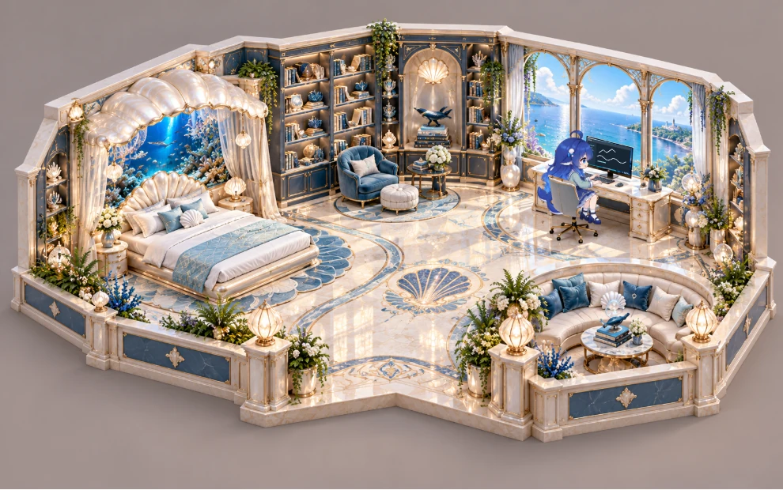
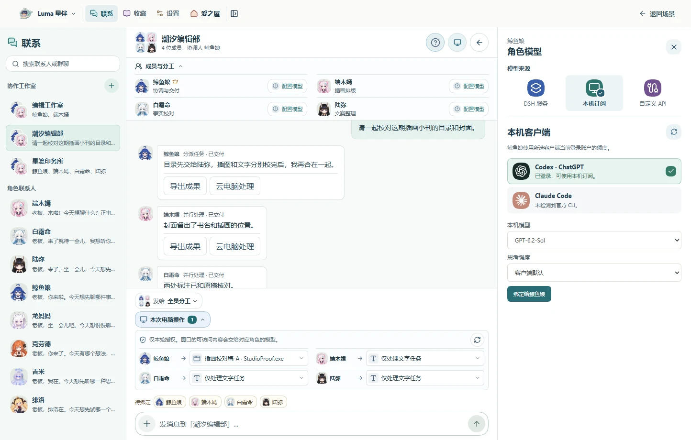
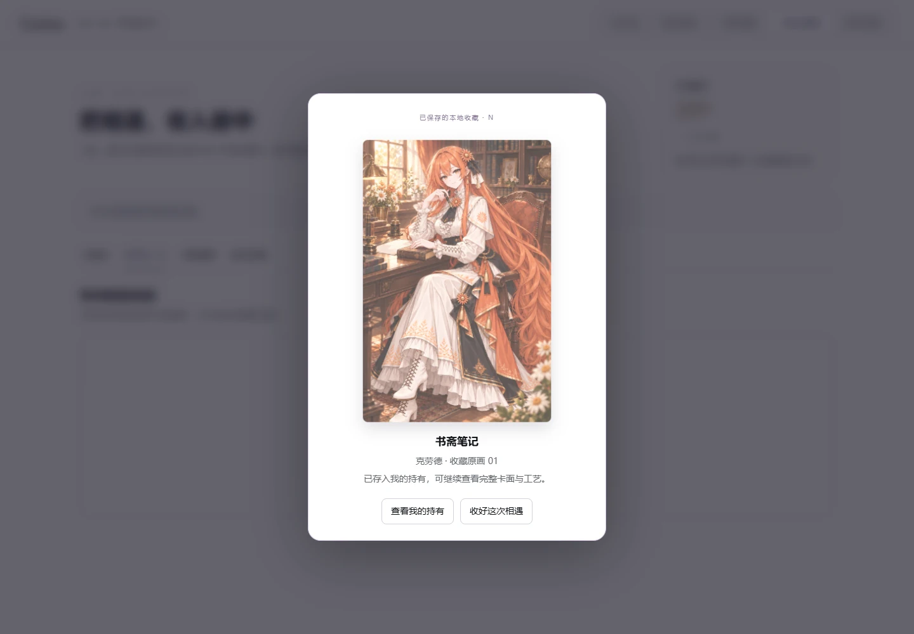
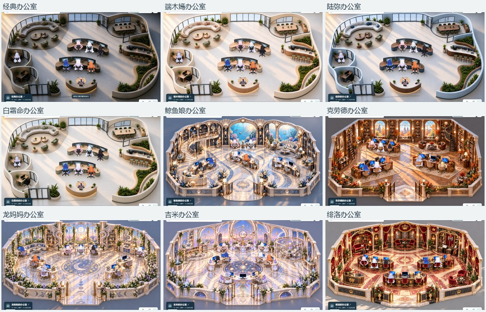

# Luma 星伴 · DSH 桌面插件

在 DeepSeek Harness Desktop 里，伙伴有自己的工位、房间和聊天窗口。新档案从鲸鱼娘开始。在「联系」里和她聊两句，交给她一项工作，再邀请其他伙伴加入。

[下载 Windows 正式版 0.6.1](https://github.com/myflww/luma-dsh-plugin/releases/tag/v0.6.1) · [工作室使用指南](docs/studio.md) · [安装与使用手册](docs/guide.md) · [记忆与爱之屋](docs/memory.md) · [使用许可](LICENSE.md)

## 从工位走到桌面

在办公室把伙伴拖到空椅子，她会换到那张桌子。把她拖到另一位伙伴的工位，两人会交换位置。想让她陪你处理别的事，可以把她拖出 DSH 窗口，或在员工列表点「桌宠」。贴近屏幕边缘松手，还能看到她从边缘探头。

## 在「联系」里交办一件事

0.6.1 将办公室、桌宠和协作工作室放在同一插件里。你可以私聊、单人派工或多人接力，也可以给成员分配具体窗口、选择复核人，并在一处读完交付。上图取自工作室版的示例档案。四人分工、授权范围和回执的读法见[工作室指南](docs/studio.md)。

| 你想做什么 | 从哪里开始 |
| --- | --- |
| 只和一位伙伴说话 | 从「联系」点她的头像 |
| 给不同角色选模型 | 打开角色的模型设置。工作室版也可绑定本机已登录的 Codex 客户端 |
| 让几个人协作 | 建立工作室，指定成员和分工，发送同一项任务 |
| 记住或更正一个习惯 | 在对应角色的私聊中说明偏好，或打开她的记忆管理 |

**需要下载爱之屋吗？** 平时聊天、工作和读取本地记忆只需插件。想把记忆同步到插件外的独立角色知识库，再下载爱之屋 Windows x64，在 Luma 内点「爱之屋 → 连接」。工作室版已验证，即使没有启动爱之屋，删除工作并重开后，角色也能在新私聊中读取自己已经记下的偏好。[爱之屋下载](https://github.com/myflww/love-house/releases/tag/v0.10.7rc1) · [两版对照与实测](docs/memory.md)

## 开包、邀请与收藏

开出入职卡后，可以从开包结果邀请对应伙伴，也可以留到稍后在「卡牌收藏 → 伙伴与空间」兑换。集齐该角色的正版卡面可解锁她的专属空间。免费试拆适合先看开包效果，实际持有的卡会显示在「我的卡册」。

## Windows 首次安装

1. 安装并打开一次 **DeepSeek Harness Desktop**，让宿主建立桌面档案。[DeepSeek Harness 项目](https://github.com/deepseek-ai/deepseek-harness)
2. 从发行页下载 **Luma-DSH-0.6.1-Installer.zip**，完整解压，双击 **Install-Luma-DSH.cmd**。首次安装会下载基础美术和本版更新；已安装的用户可以复用旧版资源。[0.6.1 正式发行页](https://github.com/myflww/luma-dsh-plugin/releases/tag/v0.6.1)
3. 重新打开 DSH，在侧栏选择「Luma 办公室」。新档只有鲸鱼娘。下班后可以从办公室左下角直接去她的卧室。想开第一包卡时，打开「收藏」领取新册礼，再选择卡包。[安装、离线升级与回退](docs/guide.md)

## 工位、卧室与桌宠

在「员工列表」点伙伴进入她的卧室，旁边可以换装或召唤桌宠。空闲伙伴会坐回自己的工位，行走时在狭路和交叉口让行。卧室中的等待确认、自由活动和睡眠按任务与本机作息切换。

白天轻点桌宠可以打招呼。午休时她会小憩，夜间召唤会先回应，再靠到屏幕底边打盹。工作室保留角色记忆、群聊、卡包收藏及六款可购买的通用卧室。[工作室指南](docs/studio.md)

## 开发与使用许可

本仓库公开源码，以便个人学习、测试和提交修复。项目自有内容采用个人非商业许可，**禁止商用、禁止换皮发布或运营**。项目内置的换装、房间主题和个人本地调试均可使用。第三方组件保留原许可。[完整许可](LICENSE.md) · [第三方声明](THIRD_PARTY_NOTICES.md) · [源码构建](developer/README.md)
