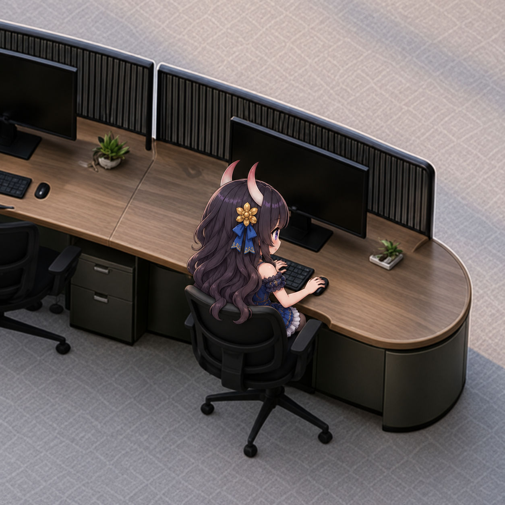

# 经典办公室北排右席 · 坐姿制作范本

图二中央大图对应这个原图。岗位是经典办公室北排最右侧的木桌，代码键为 `classic / west-studio`。此席采用从人物后上方观察的浅斜角，画面可见少量右脸、近侧手臂和椅背。

| 部位 | 制作要求 |
| --- | --- |
| 椅面与承重 | 先按空椅确定两侧扶手之间的座面。骨盆落在座面内，腰靠近椅背，坐下后裙摆压在坐垫上。大腿从髋向桌下伸，小腿自然弯下。这个镜头里，椅背、近侧扶手和桌沿遮住双脚。 |
| 电脑朝向 | 椅子开口、人物胸口和双膝大致朝向本席键盘，头和视线抬向键盘后方那块屏幕。参考场景坐标为坐垫中心 `(1042, 414)`、键盘中心 `(1041, 385)`、屏幕中心 `(1058, 349)`。这三个点在画面中的偏移决定本席转身角度。 |
| 双手与桌面 | 左手指尖落在键区。右手顺着前臂伸到键盘右侧，掌心贴住鼠标，食指、中指沿鼠标前端自然弯曲。右鼠标中心约为 `(1065, 393)`。肩肘放松，腕部顺接桌沿。工作动作中允许指尖小幅起落，髋部保持落座。 |
| 衣发与遮挡 | 椅背挡住后腰，少量发梢可以顺着椅背上沿垂到外侧。近侧扶手及支架遮住外侧裙边，露出的裙摆仍可从扶手内侧看到。右前臂越过桌前缘，手掌盖住一部分鼠标，指尖和鼠标边界均应可辨。 |

**陆弥的造型另按已定原装制作。** 原装依据 `lu-mi-walk-down-v2.5cef2e4611ef.png` 第 0 格，保留黑色长直发、红尖细角、金色叶饰、露肩深蓝短裙、纱质后摆与黑丝袜。范本中的卷发和蓝色蝴蝶结属于这张示意画。重画时采用原装的头发与发饰，跟随范本的是落座深度、身向、手部接触与家具遮挡。

验收用相同镜头、缩放和光照进行。先对照空椅检查坐深，再以正常显示尺寸回放一次工作动作，能看清左手打字、右手持鼠标，并保持椅背与裙摆的前后关系。

原图尺寸为 1254 × 1254 像素，SHA-256 为 `6dd3a9802d2c81cf7dc93531725dbce10afc90d4995ee5410cf453e1903ad3f8`。
