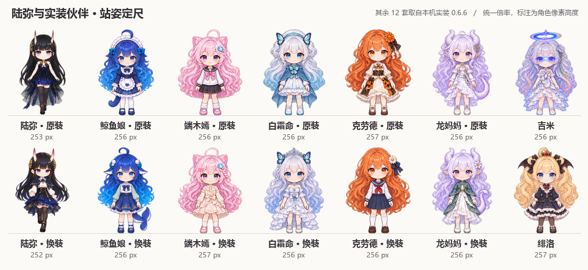

# 伙伴闲下来时怎么站

刚好没人说话时，八位伙伴像角色合照里那样面朝前，肩膀放松，双手垂在身旁，双脚自然承重。陆弥的脚尖轻轻交叠，保留她原画的站姿。站上一会儿，能看见她们眨眼，发梢和裙边随呼吸轻轻起落。等端木嫣想给人打气，或白霜命想侧过头细听，才会抬手、换步，做完再站回原处。

## 十四套衣装

下表的原画可以点开看透明大图。左右均以看图者的方向为准。陆弥两套使用各自的原画定位，其余伙伴保留实装的日常站姿，个性更多体现在她们偶尔会做什么。[六位伙伴的角色设定](../developer/overlays/deepseek-harness/luma-full/files/packages/client/ui-brand-official/src/companion/companion-fiction.ts) · [吉米与绯洛的角色设定](../developer/overlays/deepseek-harness/luma-full/files/packages/client/ui-brand-official/src/companion/companion-prepared-identities.ts)

| 伙伴与原画 | 平时站着的样子 | 驻足时的两个小动作 |
| --- | --- | --- |
| 白霜命 · [蓝披肩](../developer/modules/luma-dsh-plugin/art/actor-poses-keys/standing/bai-shuangming-base.png) | 她平视前方，双手从披肩开口垂在白裙两边。两只蓝白鞋稍稍分开，披肩的尖角落在脚踝外侧。 | 她理顺披肩时，一脚承重，另一只脚轻点。托手细看时，脚步前后错开，视线移到掌心。这位资料研究员看东西总肯多花一会儿。 |
| 白霜命 · [白色礼服](../developer/modules/luma-dsh-plugin/art/actor-poses-keys/standing/bai-shuangming-v1.png) | 手臂沿裙侧放下，手指自然微曲，两只浅色鞋从前短后长的裙摆中露出。蓝蝶发饰与小冠衬着她正面的浅笑。 | 她并近双脚，沿浅色裙褶轻抚一遍。轮到侧听，才将一只鞋错到另一只前面，微微转身，抬手拢发。 |
| 端木嫣 · [水手上衣](../developer/modules/luma-dsh-plugin/art/actor-poses-keys/standing/shan-base.png) | 白袖口停在黑色短裙两旁，手指朝下。两只粉鞋自然分开，胸前的大蝴蝶结完整露着。 | 这位沙龙主持人握拳打气时会屈起一腿，把力气送到拳上。合掌轻拍时肩胯侧转，换另一只脚站稳。 |
| 端木嫣 · [粉色蕾丝裙](../developer/modules/luma-dsh-plugin/art/actor-poses-keys/standing/shan-v1.png) | 双手自然落到腰间蝴蝶结下方，指尖停在两侧裙边。两只粉鞋都落地，浅粉裙层在身前铺开。 | 提裙行礼时双膝微屈，裙层随身体降低。掩嘴轻笑时重新站高，由画面左脚承重，另一只鞋轻轻抬起。 |
| 陆弥 · [无袖深蓝裙](../developer/modules/luma-dsh-plugin/art/actor-poses-keys/standing/lu-mi-base.png) | 长直黑发垂在肩后，金叶发饰露在鬓边。短裙后的纱摆垂落，两手自然放低，双脚轻轻交叠。 | 整理丝带时，她抬手轻触身前的饰带。致意时，一手展掌，另一手收在腰前。她熟悉典仪，两段都以手势为主，裙下只留小幅重心变化。 |
| 陆弥 · [短披肩与深色靴](../developer/modules/luma-dsh-plugin/art/actor-poses-keys/standing/lu-mi-v1.png) | 白色袖口从蓝金披肩下露出，两手垂在裙外。靴尖的金色星纹朝前，领口的扣饰也看得清楚。 | 她站稳两只靴子，伸手拢好披肩。邀请人同行时才朝旁边开半步，一手摊开，肩和目光一起转过去。 |
| 鲸鱼娘 · [海军蓝围裙](../developer/modules/luma-dsh-plugin/art/actor-poses-keys/standing/jingyuniang-base.png) | 她双手放在白围裙两旁，露出正中的小鲸图案。蓝鞋踩平，尾巴从裙后绕向画面左侧。 | 这位生活策划会低头抚平围裙，双脚收在身下。回头看尾鳍时，膝盖向同侧转，鞋子错开，目光落到身后的蓝尾上。 |
| 鲸鱼娘 · [薄荷色开衫](../developer/modules/luma-dsh-plugin/art/actor-poses-keys/standing/jingyuniang-v1.png) | 薄荷绿袖子沿蓝裙垂下，两只蓝鞋轻轻分开。宽大的尾鳍露在画面右边，静止时也认得出她。 | 她松膝再站直，抬起双臂伸个懒腰。张臂找平衡时换用画面左脚支撑，另一膝抬起，尾鳍从身后舒展开。 |
| 龙妈妈 · [白紫礼裙](../developer/modules/luma-dsh-plugin/art/actor-poses-keys/standing/longmama-base.png) | 双手松垂在白紫裙边，正面能看见两只花饰鞋。她轻轻含笑，紫色卷尾停在画面右侧，与裙摆留出空隙。 | 拢发到耳后时一脚稳住，另一脚斜点。安抚人时收近脚步，稍稍俯身，把手放低，让动作温和下来。 |
| 龙妈妈 · [深绿披风](../developer/modules/luma-dsh-plugin/art/actor-poses-keys/standing/longmama-v1.png) | 绿披风在身前敞开，白袖口和手指从两侧垂下。两只白靴平稳着地，卷尾贴近披风外侧。 | 她拂过披风下摆，一脚顺势斜点。回看卷尾时重新收近靴子，肩和眼睛一起转向画面右侧。 |
| 克劳德 · [雏菊礼裙](../developer/modules/luma-dsh-plugin/art/actor-poses-keys/standing/claude-base.png) | 她正面看人，橙色花饰与长卷发框着脸。两只手垂在橙黑蝴蝶结外侧，棕色搭扣鞋并排落地。 | 这位校勘人表示会意时闭眼点头，把双手收在腰前。心里默数时抬起一手逐指确认。两段都让脚步保持安稳。 |
| 克劳德 · [水手领制服](../developer/modules/luma-dsh-plugin/art/actor-poses-keys/standing/claude-v1.png) | 双臂垂在蓝色百褶裙两侧，两只棕鞋稍稍分开。白色雏菊戴在发间，红领结落在胸前。 | 她低头理领结，双膝略收。听到需要回应的地方就举手，身体随之伸展，另一腿轻轻向后屈起。 |
| 吉米 · [折光面罩](../developer/modules/luma-dsh-plugin/art/actor-poses-keys/standing/gemini-v1.png) | 两手松垂，浅色鞋在层层裙褶下踩稳。她透过面罩平视前方，眼睛、镜面反光和头顶光环都能分别看清。 | 这位多媒体资料研究员调面罩时先站稳再扶镜。描星轨时才把一脚轻点向侧边，抬起手指，仰头跟着指尖看。 |
| 绯洛 · [皇冠与黑金礼裙](../developer/modules/luma-dsh-plugin/art/actor-poses-keys/standing/grok-v1.png) | 双手垂在深色裙摆两侧，圆头鞋着地。她带着一点笑意，皇冠、翼形发饰和金色双卷发从正面看层次分明。 | 她扶正小皇冠时右侧脚踩实，另一侧脚跟抬起。这位展演企划摊手反问时会换脚承重，向外探出另一脚，歪头等回答。 |

自然驻足满一轮呼吸后，才会开始第一段小动作。两段之间还有一轮完整的日常待机。抓起、行走、入座、睡觉、靠边探头或开启「减少动态」，都会中断正在做的动作。[14 套造型的 28 段小动作](images/idle-gestures-065.gif)

## 从站稳到回望

办公室、卧室与 Windows 桌宠共用每套造型的 24 帧待机。呼吸时身体略有起伏，发梢与衣边稍后回落，鞋底仍在原处。眨眼只占其中几帧。Windows 桌宠在眼睑闭合时会暂停普通视线跟随。[待机动图](images/standing-outfits-065.gif)

放下伙伴后，可以把光标从她的右上方缓缓移到左下方。她回弹站稳，眼睛先找到光标，头部稍后跟上。吉米转眼时还能看见镜片下的瞳色。跟随约两秒半后，头和眼睛逐渐回正，呼吸接回原来的节奏。[14 套头眼转向对照](images/release-look-065.gif) · [实际拖放与光标位置](images/post-drop-look.gif)

## 绘制参考

Q 版角色放到办公室里很小。辨认她们主要靠头身比例、头发、衣装轮廓和饰品。例如鲸鱼娘在两套衣装里露出的尾鳍方向不同，端木嫣两套衣装的领结、裙长和鞋袜也各有特点。[Clip Studio 的 Q 版人物绘制教程](https://www.clipstudio.net/how-to-draw/archives/155423)

抬手、转身、行礼时，先看哪只脚在支撑身体，再看肩、胯、膝和手的走向。手离开身侧才开始表达具体意思，动作结束时身体重新立稳。动画师 Anthony Wong 的示范用肩胯的角度和剪影来检查这种着力关系。[Animation Mentor 站姿示范](https://www.animationmentor.com/blog/tutorial-building-appealing-character-poses-for-animation/)

细小的表情要看眼睑何时落下、何时重新睁开。发梢、袖口和裙摆的回落比身体略迟，在停住的那一刻最容易观察。[Live2D 表情教程](https://docs.live2d.com/en/cubism-editor-tutorials/expression/) · [Live2D 物理摆动教程](https://docs.live2d.com/en/cubism-editor-tutorials/physical-calculation-settings/)
