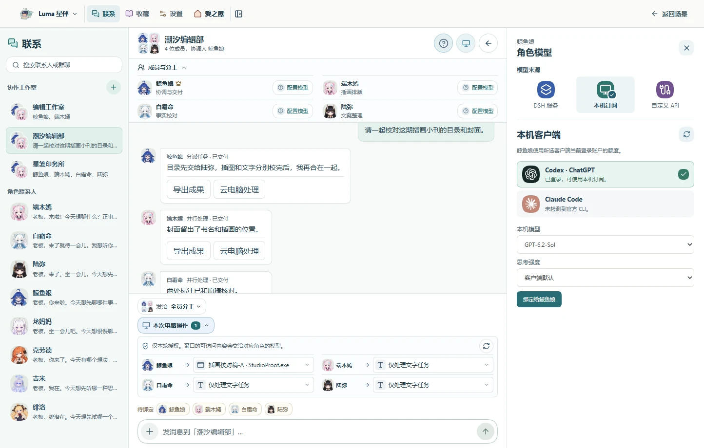

# 工作室版 · 从窗口操作到交付

工作室适合多位伙伴协作、跨工作记住偏好，或让成员操作具体应用窗口。0.6.1 将工作室、办公室和桌宠整合在同一插件中。[下载 Windows 正式版](https://github.com/myflww/luma-dsh-plugin/releases/tag/v0.6.1)

## Windows 安装

在 Windows 上先打开一次 DeepSeek Harness Desktop。下载工作室发行页的 **Luma-DSH-Studio…zip**，解压整个文件夹，双击 **Install-Studio.cmd**。安装器优先复用已有基础资源，首次安装会从公开发行页获取约 1.87 GB 的基础分卷，逐项校验后注册。重启 DSH，在侧栏打开「Luma 办公室」。

使用自定义宿主路径时，可运行 `Install-Studio.ps1 -DshCli "D:\Apps\DeepSeek Harness\resources\runtime\cli\bin\dsh.cmd"`。离线安装可用 `-Base` 指向完整的 0.5.4 插件目录或官方 0.4.3 基础 ZIP。只想还原文件可添加 `-PrepareOnly`，然后在 DSH 的插件页选择生成的目录。保留该目录，DSH 会从这里加载插件。

## 跑一项四人任务

1. 在「联系」新建工作室，邀请四位已入职伙伴。让鲸鱼娘负责协调与最终交付。
2. 点角色的模型按钮，为每位伙伴选择 DSH 服务、本机订阅或自定义 API。选择本机订阅时，先确认设置显示客户端已登录，再绑定给角色。
3. 在「本次电脑操作」中分别给端木嫣和陆弥选择窗口，让白霜命担任复核人。只选择希望模型读取和操作的窗口。
4. 把一项完整任务发到工作室。展开「窗口回执」可看两位操作者分别做了什么、窗口返回了什么、白霜命的逐份结论，以及结果是否已交给鲸鱼娘。若读值不完整，记录会保留待确认状态。

| 在哪里查看 | 能看到什么 |
| --- | --- |
| 原窗口 | 操作实际产生的结果 |
| 工作室的「窗口回执」 | 目标窗口、操作、回读值、复核结论 |
| 协调人的汇总 | 本轮已交付的结果，以及尚待处理的项 |

当前 Windows 版本已验证可定向操作能够唯一识别的原生输入框和按钮。角色可以同时规划和观察，实际写入会排队，并在原窗口复核。浏览器窗口支持只读预览。

## 边工作边聊天

点角色头像返回私聊，工作室任务可以继续执行。私聊保留各自的人格和话题上下文。项目中的长期偏好由各角色分别整理。清理工作记录时，已经形成的偏好条目另行管理。[记忆与删除的具体行为](memory.md)

在联系页的记录管理中可以归档任务或聊天，再从归档中恢复。只想收起历史内容时，优先使用归档。需要清除来源记录时，按界面提示确认删除，所选范围会显示在确认框中。

## 源码与许可

标签内的 `developer/` 包含本次工作室版对应的源码和构建入口。桌宠版 0.6.0 继续独立提供。两版均适用个人非商业、禁止换皮条款，第三方组件遵循各自许可。[工作室源码](https://github.com/myflww/luma-dsh-plugin/tree/v0.6.1/developer) · [桌宠版](https://github.com/myflww/luma-dsh-plugin/releases/tag/v0.6.0) · [使用许可](../LICENSE.md)
